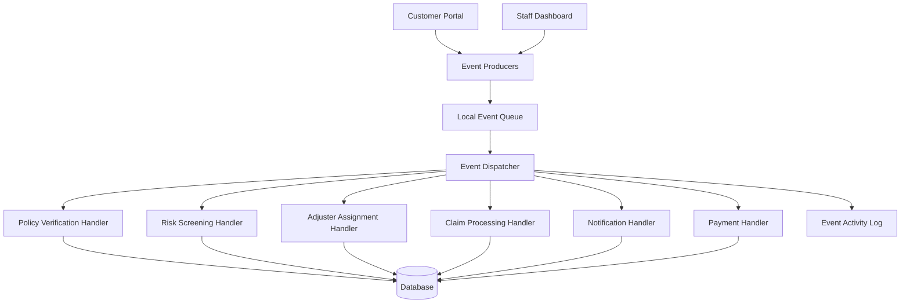

# InsureFlow – Event-Driven Insurance Claims Automation

**A Node.js-based Event-Driven Programming (EDP) project demonstrating automated insurance claim processing through event producers, a local event queue, an event dispatcher, and independent event handlers.**

## Project Overview

InsureFlow is a car insurance claims management and automation system designed to demonstrate the principles of Event-Driven Programming.

The application allows customers to submit insurance claims, provide supporting documentation, and monitor claim progress. Insurance staff can review submitted claims, assign adjusters, approve or reject claims, and process approved payments.

Instead of relying on direct function calls between every component, InsureFlow uses an event-driven architecture. When an action occurs, an event is generated, placed into an event queue, and processed by the appropriate event handlers.

The project demonstrates how independent system components communicate and respond to events in an organized and scalable way.

## Live Application

- **Live Website:** [Insurance Claim SystemL](https://insurance-claim-system-gonp.vercel.app/)
- **Local Frontend:** http://localhost:5173
- **Local Backend API:** http://localhost:3000

> Replace the Vercel placeholder with the actual deployment URL once the application is published.

## Main Features

### Customer Portal
- Submit new car insurance claims.
- Enter policy, vehicle, accident, and damage information.
- Upload supporting documents and evidence.
- View submitted claims and their current status.
- Track claim processing progress.
- Receive notifications about claim updates.

### Staff Dashboard
- View all submitted insurance claims.
- Monitor pending, approved, rejected, and flagged claims.
- Search and filter claims.
- Review claim information and uploaded evidence.
- Assign insurance adjusters.
- Approve or reject claims.
- Record payments for approved claims.
- Monitor system events through the activity log.

### Event-Driven Automation
- Automatic event generation following user actions.
- Local event queue for handling incoming events.
- Event dispatcher for distributing events.
- Independent event handlers for specific operations.
- Event logging with timestamps and unique identifiers.
- Automatic claim status updates and customer notifications.

## Technologies Used

| Technology | Purpose |
|---|---|
| Node.js | Backend runtime environment |
| Express.js | Backend API |
| TypeScript / JavaScript | Application logic and event processing |
| React | Frontend user interface |
| Vite | Frontend development and build tool |
| SQLite / JSON storage | Persistent application data |
| CSS / Tailwind CSS | User interface styling |
| Git & GitHub | Version control and project hosting |
| Vercel | Frontend deployment |

*The actual technology list should match the dependencies and implementation in this repository.*

## Event-Driven Architecture

InsureFlow follows an event-driven architecture consisting of four main components:

1. **Event Producers:** Generate events when customers or staff perform actions.
2. **Event Queue:** Temporarily stores events before processing.
3. **Event Dispatcher:** Retrieves events from the queue and sends them to the appropriate handlers.
4. **Event Handlers:** Independently process events and perform specific operations.

### Architecture Flow



## Implemented Events

The application uses the following events to represent important system activities:

| Event | Description |
|---|---|
| `claim_submitted` | A customer submits a new insurance claim. |
| `policy_verified` | The submitted insurance policy passes verification. |
| `policy_verification_failed` | Policy verification fails. |
| `document_uploaded` | Supporting claim documentation is uploaded. |
| `claim_flagged` | A claim is flagged for additional review. |
| `adjuster_assigned` | An insurance adjuster is assigned to a claim. |
| `claim_approved` | A staff member approves a claim. |
| `claim_rejected` | A staff member rejects a claim. |
| `customer_notified` | A customer receives a claim status notification. |
| `payment_processed` | Payment is recorded for an approved claim. |

For detailed event payloads, producers, and handlers, see **[events.md](events.md)**.

For a detailed explanation of the system architecture, see **[architecture.md](architecture.md)**.

## Example Event Workflow

A typical insurance claim follows this process:

1. A customer submits an accident claim.
2. The system generates a `claim_submitted` event.
3. The event enters the local event queue.
4. The dispatcher distributes the event to relevant handlers.
5. The policy verification handler checks the submitted policy information.
6. The risk screening handler evaluates the claim using demonstration rules.
7. The system updates the claim status and records the resulting events.
8. An adjuster can be assigned to the claim.
9. Staff review the claim and approve or reject it.
10. If approved, a payment can be recorded.
11. The customer receives a notification about the outcome.

All important event activity is recorded for monitoring and demonstration purposes.

## Installation and Setup

### Prerequisites

Install the following before running the application:

- Node.js (LTS version recommended).
- npm.
- Git.
- Visual Studio Code (recommended).

Check your installations:

```bash
node -v
npm -v
```

### Clone the Repository

```bash
git clone https://github.com/Rita-ST/Insurance-Claim-System-.git
cd insureflow
```

### Install Dependencies

Follow the package structure in the repository.

For a project with separate frontend and backend folders:

```bash
cd backend
npm install
```

Open a second terminal:

```bash
cd frontend
npm install
```

### Run the Application

Start the backend:

```bash
cd backend
npm run dev
```

Start the frontend in a separate terminal:

```bash
cd frontend
npm run dev
```

Open the frontend in your browser:

http://localhost:5173

> If your repository uses different folder names or npm scripts, follow the actual `package.json` configuration.

## Testing

Run the backend tests using:

```bash
npm test
```

Run the production build using the appropriate frontend command:

```bash
npm run build
```

The project should be tested for:

- Event queue functionality.
- Event dispatcher functionality.
- Event handler execution.
- Claim submission and validation.
- Policy verification.
- Claim approval and rejection.
- Payment restrictions.
- Event logging.
- Data persistence.

## Project Structure

```text
insureflow/
│
├── frontend/
│   ├── src/
│   ├── public/
│   └── package.json
│
├── backend/
│   ├── src/
│   │   ├── events/
│   │   ├── handlers/
│   │   ├── queue/
│   │   ├── routes/
│   │   └── server.ts
│   ├── tests/
│   └── package.json
│
├── README.md
├── events.md
├── architecture.md
└── .gitignore
```

*The structure above illustrates the intended organization; actual folders may differ depending on the implementation.*

## Educational Purpose

This project was developed as part of a university Event-Driven Programming assignment.

Its main objective is to demonstrate:

- Event producers and consumers.
- Event queues and dispatchers.
- Event-driven communication.
- Independent event handlers.
- Asynchronous processing.
- Event payloads and event logging.
- Separation of concerns and modular software design.

InsureFlow uses simulated insurance verification, risk assessment, notifications, and payment processing. It is an educational demonstration and is not intended for real insurance transactions.

## Author

**Rita Gadlela**

Computer Engineering  
Event-Driven Programming (EDP) Project

## License

This project was created for educational and academic purposes.
