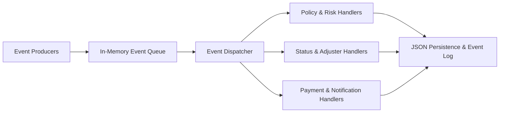

# InsureFlow System Architecture

## Event-Driven Pipeline
InsureFlow decouples user actions (Producers) from business side-effects (Handlers) using an in-memory FIFO Event Queue and Event Dispatcher.

## Component Responsibilities
1. Event Producers: UI actions and REST endpoints publish immutable event objects rather than mutating downstream states directly.
2. Event Queue: Buffers incoming events with unique EVT-XXXXXXXX identifiers and ISO-8601 timestamps.
3. Event Dispatcher: Dequeues events sequentially, invokes all registered subscribers for that EventName, handles exceptions safely, and writes the final status to the Event Log.
4. Independent Event Handlers: Single-responsibility functions that react to events and emit secondary cascading events.
